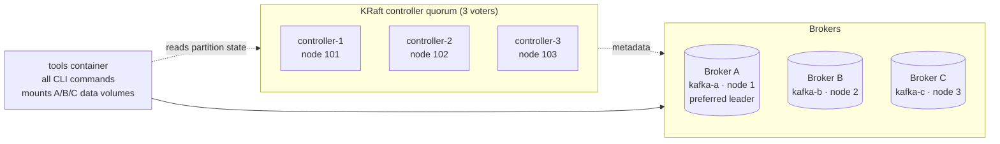

# Eligible Leader Replicas (ELR) vs. non-ELR: the "last replica standing" demo


- [Eligible Leader Replicas (ELR) vs. non-ELR: the "last replica standing" demo](#eligible-leader-replicas-elr-vs-non-elr-the-last-replica-standing-demo)
  - [Disclaimer](#disclaimer)
  - [What this demo actually shows](#what-this-demo-actually-shows)
  - [Architecture](#architecture)
    - [Design choices](#design-choices)
  - [How to Get Started](#how-to-get-started)
    - [Prerequisites](#prerequisites)
    - [Pinned version (`.env`)](#pinned-version-env)
    - [Scripts](#scripts)
    - [Quick start (guided runs)](#quick-start-guided-runs)
  - [Run 1: ELR disabled](#run-1-elr-disabled)
    - [Step 1: Fresh cluster, ELR off, topic with ISR {A,B,C}](#step-1-fresh-cluster-elr-off-topic-with-isr-abc)
    - [Step 2: Stop C, wait for ISR {A,B}, write the committed checkpoint](#step-2-stop-c-wait-for-isr-ab-write-the-committed-checkpoint)
    - [Step 3: Stop B, wait for ISR {A}, send lower-ack writes](#step-3-stop-b-wait-for-isr-a-send-lower-ack-writes)
    - [Step 4: Kill A, then simulate loss of A's partition data](#step-4-kill-a-then-simulate-loss-of-as-partition-data)
    - [Step 5: Bring the stale A back first, then B](#step-5-bring-the-stale-a-back-first-then-b)
  - [Run 2: ELR enabled](#run-2-elr-enabled)
    - [Step 1: Fresh cluster, ELR on, topic with ISR {A,B,C}](#step-1-fresh-cluster-elr-on-topic-with-isr-abc)
    - [Step 2: Stop C, wait for ISR {A,B}, write the committed checkpoint](#step-2-stop-c-wait-for-isr-ab-write-the-committed-checkpoint-1)
    - [Step 3: Stop B, wait for ISR {A}, send lower-ack writes](#step-3-stop-b-wait-for-isr-a-send-lower-ack-writes-1)
    - [Step 4: Kill A, then simulate loss of A's partition data](#step-4-kill-a-then-simulate-loss-of-as-partition-data-1)
    - [Step 5: Bring the stale A back first, then B](#step-5-bring-the-stale-a-back-first-then-b-1)
  - [Alternative: B comes back first](#alternative-b-comes-back-first)
  - [Evidence to capture](#evidence-to-capture)
  - [Stop / Clean](#stop--clean)
  - [Notes](#notes)
  - [References](#references)


Sources:
- [KIP-966: Eligible Leader Replicas](https://cwiki.apache.org/confluence/display/KAFKA/KIP-966%3A+Eligible+Leader+Replicas)
- [Apache Kafka docs: Eligible Leader Replicas](https://kafka.apache.org/43/operations/eligible-leader-replicas/)

This demo runs a local Confluent Platform 8.1 cluster with Docker Compose and drives one single-partition topic (RF=3, `min.insync.replicas=2`) into the **last-replica-standing** case. It then runs the same fault sequence twice:

- **Run 1: ELR disabled** (`eligible.leader.replicas.version=0`)
- **Run 2: ELR enabled** (`eligible.leader.replicas.version=1`, the default on new CP 8.1 clusters)

Every step checks the **producer result**, **what the consumer can see**, and the **partition metadata**: leader, ISR, ELR, high watermark (HWM), and each replica's log-end offset (LEO).

## Disclaimer

> **This is a disposable local lab, not a production template and not official Confluent material.**
>
> - It is provided as-is, without warranty or support, for learning and demonstration only.
> - Some steps are **intentionally destructive**. `wipe-partition.sh` deletes a partition directory from a broker volume to simulate disk loss. Run it only against the Docker volumes this project creates. Never point these scripts at a real cluster.
> - The topic uses `unclean.leader.election.enable=false` by default (the Kafka default). The [alternative sequence](#alternative-b-comes-back-first) turns it on deliberately, to show the lossy recovery path. Don't copy that setting into a real system without understanding the trade-off.
> - All security is turned off (PLAINTEXT, no authentication, no ACLs), and every node runs with a small heap.
> - Behaviour is tied to the pinned versions (CP `8.1.6`). Other versions may behave differently, especially versions before Apache Kafka 3.7 (see [What this demo actually shows](#what-this-demo-actually-shows)).
> - Confluent Server (`cp-server`) runs under its trial/developer license terms. You are responsible for complying with the Confluent license for any images you pull.
> - The observations below are what this lab produced. They are not a statement of supported product behaviour. Check the official documentation before drawing production conclusions.

## What this demo actually shows

A common expectation is that with ELR off, `acks=1` writes become **consumer-visible** while ISR = 1, and are then lost on failover. **That does not happen on CP 8.1.x, and the demo shows why:**

1. **The HWM freezes below min ISR in both runs.** Since Apache Kafka **3.7** (CP 7.7), the leader stops advancing the high watermark whenever `ISR size < min.insync.replicas` (`Partition.maybeIncrementLeaderHW`, KIP-966 part 1). This check is unconditional: it does *not* depend on the `eligible.leader.replicas.version` feature. So on CP 8.1, an `acks=1` write made while ISR = `{A}` is appended and acknowledged by A, but stays above the HWM and is **invisible to consumers in both runs**. The older behaviour, where the record became visible, only exists on Kafka ≤ 3.6 / CP ≤ 7.6.

2. **What the ELR feature flag changes on CP 8.1 is leader election.** With the feature at 1, the controller records which replicas left the ISR while holding everything up to the frozen HWM (the `Elr:` column). With the feature at 0, it doesn't, and recovery falls back to "last ISR member" or an unclean election.

| Fault sequence | Run 1: ELR **disabled** | Run 2: ELR **enabled** |
|---|---|---|
| ISR drops to `{A}` (B stopped cleanly) | `elr=` empty | `elr=B`: B is known to be safe |
| `acks=1` write while ISR = `{A}` | acknowledged, **invisible** (HWM frozen) | acknowledged, **invisible** (HWM frozen) |
| `acks=all` write while ISR = `{A}` | `NotEnoughReplicasException` | `NotEnoughReplicasException` |
| A killed, its partition data wiped, then **A comes back first** (default sequence) | A is still the sole ISR member → elected **cleanly** with an empty log → **committed `acks=all` CHECKPOINT lost**, and B truncates to match when it returns. No unclean election is ever reported | A shut down uncleanly, so the controller removes it from ELR. B (in ELR) is offline, so the partition **waits** (unavailable, not lossy). When B returns it is elected from ELR → **CHECKPOINT preserved** |
| …instead **B comes back first** ([alternative](#alternative-b-comes-back-first), `UNCLEAN=true`) | B is not in the ISR → elected only through an **unclean** election. CHECKPOINT kept, but by luck: Kafka had no record that B was safe | B is in ELR → **clean** election of B. CHECKPOINT kept, and Kafka *knew* B held all committed data |

The decisive evidence is the producer/consumer output and `./status.sh`.

> **Had B come back first, data loss would have been avoided even with ELR disabled.** B holds the CHECKPOINT, and it would have become leader. With ELR disabled, though, B is not in the ISR, so that only happens through an *unclean* election (`unclean.leader.election.enable=true`). Kafka is gambling there, not choosing B because it knows B is safe. The benefit of ELR is that the outcome no longer depends on which broker restarts first.
>
> Both runs keep `unclean.leader.election.enable=false` in the default sequence. With it set to `true`, ELR-enabled clusters also elect the stale A *uncleanly* when no ELR member is online, and the CHECKPOINT is lost. ELR protects the clean election path; an explicitly enabled unclean election still trades durability for availability.

## Architecture



Topic `elr-demo`: 1 partition, replicas `[A, B, C]` (A = preferred leader), `min.insync.replicas=2`, `unclean.leader.election.enable=false` (`UNCLEAN=true` to change).

### Design choices

- **Dedicated controllers instead of `broker,controller` combined mode.** The fault sequence stops two of the three brokers. In combined mode that also stops two of the three controller voters. The quorum is lost, and no ISR shrink or leader election can be committed, so the demo would stall at step 3. Brokers A, B, C are still the labelled replicas, and the three-voter quorum moves onto `controller-1..3`.
- **A `tools` container** runs every Kafka CLI command. It stays up while brokers are down, and it mounts the three broker volumes. That lets `status.sh` read each replica's log, even for a stopped broker, and lets `wipe-partition.sh` damage only the stopped broker's partition directory.
- **Partition state is read from the controller quorum** (`kafka-metadata-shell`), so leader/ISR/ELR stay visible while **every** broker is down. `kafka-topics --describe` can't do that.

## How to Get Started

### Prerequisites

- Docker Desktop (or Docker Engine) with Compose v2
- about 4 GB of memory for Docker
- macOS/Linux shell (bash)

No local Kafka installation is needed: all CLI tools run inside the `tools` container.

### Pinned version (`.env`)

```properties
CP_VERSION=8.1.6     # confluentinc/cp-server
```

### Scripts

| Script | What it does |
|---|---|
| `start-cluster.sh` | `docker compose down -v` and `up -d`: a **fresh** cluster every time |
| `set-elr.sh enable\|disable` | Sets `eligible.leader.replicas.version` to 1 / 0 and verifies it |
| `create-topic.sh <prefix>` | Creates `elr-demo` (RF=3, replicas `1:2:3`, min ISR 2, unclean off; `UNCLEAN=true` to override) and a new run id |
| `status.sh` | Evidence: brokers up/down, ELR feature level, leader / replicas / ISR / **ELR** / LastKnownElr from the controllers, HWM, and each replica's LEO and records read from disk |
| `produce.sh <acks> <label>` | Sends one record `<run-id>\|<label>\|acks=<n>\|<time>` and reports ACKNOWLEDGED / FAILED (+ exception) / SENT (acks=0) |
| `consume.sh` | Shows every consumer-visible record (offset 0 … HWM), with no consumer group |
| `stop-broker.sh <a\|b\|c> [--unclean]` | `docker stop` (clean, controlled shutdown) or `docker kill` (crash) |
| `start-broker.sh <a\|b\|c>` | Starts a broker and waits for it to answer |
| `wipe-partition.sh <a\|b\|c>` | **Destructive**: backs up and deletes `elr-demo-0` from a **stopped** broker's volume |
| `elect-unclean.sh` | Triggers the configured unclean election right away |
| `show-elections.sh` | Lists the unclean leader elections the controller performed for `elr-demo-0` (or `none`) |
| `run-1-elr-disabled.sh` / `run-2-elr-enabled.sh` | Guided end-to-end runs: pause between steps and write everything to `evidence/` |
| `stop-cluster.sh [--purge]` | Removes all containers and volumes (`--purge` also empties `backups/` and `evidence/`) |

First time only:

```bash
chmod +x ./*.sh
```

### Quick start (guided runs)

```bash
./run-1-elr-disabled.sh     # Run 1 - ELR disabled
./run-2-elr-enabled.sh      # Run 2 - ELR enabled
```

Each run starts from a fresh cluster, pauses after every step (press Enter), and saves the full terminal output to `evidence/<run>-<timestamp>.log`. Options:

```bash
PAUSE=0 ./run-2-elr-enabled.sh                         # no pauses
RETURN_FIRST=b UNCLEAN=true ./run-1-elr-disabled.sh   # alternative: B comes back first
RETURN_FIRST=b UNCLEAN=true ./run-2-elr-enabled.sh    # alternative: B comes back first
```

The rest of this README walks through the same steps manually, one command at a time.

## Run 1: ELR disabled

### Step 1: Fresh cluster, ELR off, topic with ISR {A,B,C}

```bash
./start-cluster.sh
./set-elr.sh disable
./create-topic.sh run1-elr-off
./status.sh
```

Expected: `eligible.leader.replicas.version = 0`, `leader=A replicas=A,B,C isr=A,B,C elr=`.

### Step 2: Stop C, wait for ISR {A,B}, write the committed checkpoint

```bash
./stop-broker.sh c
./status.sh                       # isr=A,B
./produce.sh all CHECKPOINT       # ✓ acks=all ACKNOWLEDGED
./consume.sh                      # CHECKPOINT visible (HWM = 1)
```

The checkpoint is on both A and B. This is the committed record that must survive.

### Step 3: Stop B, wait for ISR {A}, send lower-ack writes

```bash
./stop-broker.sh b
./status.sh                       # isr=A  elr=   (empty: ELR is not tracked)

./produce.sh 1   TEST-ACKS1       # ✓ acks=1 ACKNOWLEDGED by the leader
./produce.sh 0   TEST-ACKS0       # ! acks=0 SENT (nothing to inspect)
./produce.sh all TEST-ACKSALL     # ✗ acks=all FAILED NotEnoughReplicasException

./consume.sh                      # still only CHECKPOINT (HWM stays 1)
./status.sh                       # A: LEO=3 (CHECKPOINT, TEST-ACKS1, TEST-ACKS0); HWM=1
```

The producer result and consumer visibility differ: A acknowledged `TEST-ACKS1`, but the HWM is frozen because ISR (1) < min ISR (2), so no consumer can read it. On CP 8.1 this holds even with ELR disabled (see [What this demo actually shows](#what-this-demo-actually-shows)).

### Step 4: Kill A, then simulate loss of A's partition data

```bash
./stop-broker.sh a --unclean      # SIGKILL = crash
sleep 15                          # let the controller fence A
./status.sh                       # leader=NONE (offline)  isr=A  elr=
./wipe-partition.sh a             # copy to ./backups/, then delete elr-demo-0 on A's volume
```

With ELR off, the controller keeps the last member A in the ISR even though it's dead.

### Step 5: Bring the stale A back first, then B

```bash
./start-broker.sh a
./status.sh                       # leader=A  isr=A   A's log is EMPTY (LEO=0), HWM=0
./consume.sh                      # nothing: the CHECKPOINT is no longer readable
./show-elections.sh               # none: this was a *clean* election
```

A is still the only ISR member, so the controller elects it **cleanly**, even though its log is empty. Nothing in the metadata says A lost its data. Now bring B back:

```bash
./start-broker.sh b
./status.sh                       # leader=A  isr=A,B   B truncated its log to match A: LEO=0 everywhere
./consume.sh                      # still nothing: the committed CHECKPOINT is lost from every replica
```

B rejoins as a follower and truncates its log to match the leader. The `acks=all` CHECKPOINT, a committed record, is gone, and no unclean election was ever reported.

> Had B come back first instead, it would have been elected and the CHECKPOINT kept, even with ELR disabled. But B is not in the ISR, so that only happens through an **unclean** election (`unclean.leader.election.enable=true`). See [Alternative: B comes back first](#alternative-b-comes-back-first).

## Run 2: ELR enabled

Same fault sequence, on a fresh cluster. Don't change `min.insync.replicas` during the run: changing it clears ELR state.

### Step 1: Fresh cluster, ELR on, topic with ISR {A,B,C}

```bash
./start-cluster.sh
./set-elr.sh enable
./create-topic.sh run2-elr-on
./status.sh                       # eligible.leader.replicas.version = 1
```

### Step 2: Stop C, wait for ISR {A,B}, write the committed checkpoint

```bash
./stop-broker.sh c
./produce.sh all CHECKPOINT       # ✓ acks=all ACKNOWLEDGED
./consume.sh                      # CHECKPOINT visible
```

### Step 3: Stop B, wait for ISR {A}, send lower-ack writes

```bash
./stop-broker.sh b
./status.sh                       # isr=A  elr=B   <- B is now an Eligible Leader Replica

./produce.sh 1   TEST-ACKS1       # ✓ acknowledged by the leader...
./produce.sh 0   TEST-ACKS0
./produce.sh all TEST-ACKSALL     # ✗ NotEnoughReplicasException
./consume.sh                      # ...but invisible: only CHECKPOINT (HWM frozen at 1)
```

B left the ISR through a clean shutdown while holding every record up to the now-frozen HWM, so the controller records it in ELR. ELR is **metadata about which replicas are safe**, not an extra copy of the data.

### Step 4: Kill A, then simulate loss of A's partition data

```bash
./stop-broker.sh a --unclean
sleep 15
./status.sh                       # leader=NONE  isr=  elr=A,B  lastKnownElr=A
                                  # (A, the last ISR member, also moves to ELR when it is fenced)
./wipe-partition.sh a             # B's volume stays intact
```

### Step 5: Bring the stale A back first, then B

```bash
./start-broker.sh a
./status.sh                       # leader=NONE (offline)  isr=  elr=B   A is no longer in ELR
./consume.sh                      # partition has no leader: unavailable, not lost
```

A registers after an unclean shutdown, so the controller removes it from ELR: its log may be missing data it acknowledged. B, the remaining ELR member, is offline, and unclean election is disabled, so the partition **waits**. Now bring B back:

```bash
./start-broker.sh b
./status.sh                       # leader=B  isr=B,A
./consume.sh                      # CHECKPOINT preserved
./show-elections.sh               # none: B was elected cleanly from ELR
```

B is elected **from ELR**, as a clean election, and A rejoins as its follower and copies the CHECKPOINT back. `TEST-ACKS1` was never consumer-visible (it sat above the frozen HWM), so its absence is **not** a loss of committed data.

## Alternative: B comes back first

If B, the replica that holds the CHECKPOINT, is the first broker back, both runs keep the data. Run 1 can only get there through an unclean election, so this sequence needs `UNCLEAN=true`:

```bash
RETURN_FIRST=b UNCLEAN=true ./run-1-elr-disabled.sh
RETURN_FIRST=b UNCLEAN=true ./run-2-elr-enabled.sh
```

or manually: create the topic with `UNCLEAN=true ./create-topic.sh <prefix>`, repeat steps 2–4, then:

```bash
./start-broker.sh b
./status.sh                       # leader=B  isr=B
# if leader is still NONE after ~30s, trigger the configured unclean election:
./elect-unclean.sh
./consume.sh                      # CHECKPOINT visible
./show-elections.sh
./start-broker.sh a               # A rejoins as a follower and copies B's log
```

- **ELR disabled:** B is not in the ISR, so it is elected through an **unclean** election (`show-elections.sh` prints `UNCLEAN … leader: -1 -> 2`). The CHECKPOINT survives because B happens to hold it, but Kafka had no record of that. With `UNCLEAN=false` the partition would simply have waited for A, and lost the CHECKPOINT as in the default sequence.
- **ELR enabled:** B is in ELR, so it is elected **cleanly** (`show-elections.sh` prints `none`). Kafka knew B held all committed data.

So data loss can be avoided without ELR, but only if the right broker happens to restart first and unclean election is allowed. ELR makes the safe outcome independent of restart order.

## Evidence to capture

For each step, `./status.sh` and the `produce.sh`/`consume.sh` output give you:

- feature level (`eligible.leader.replicas.version`), leader, replicas, ISR, ELR, LastKnownElr
- producer `acks` mode and result / exception
- consumer-visible run ids before the failure, during the ISR = 1 interval, and after recovery
- per-replica LEO and record list, plus the elected leader after restart

The guided runs save all of this to `evidence/`. To see whether recovery needed an unclean election:

```bash
./show-elections.sh
```

At INFO level the controller logs only *unclean* partition changes (`UNCLEAN partition change for elr-demo-0 ...`). A clean election, including election from ELR, leaves no line, so the script reports `none`.

## Stop / Clean

```bash
./stop-cluster.sh            # docker compose down -v (all data removed)
./stop-cluster.sh --purge    # same, and also empties ./backups and ./evidence
```

## Notes

- Run every command from this directory.
- Use a fresh cluster for each run (`start-cluster.sh` does that), so the two runs are a fair comparison.
- Avoid changing topic or cluster `min.insync.replicas` between the point ELR state is recorded and recovery: it clears ELR metadata.
- Keep the committed checkpoint separate from the lower-ack test writes. ELR protects the known HWM boundary; it does not make uncommitted writes durable.
- If the last ISR replica disappears, ELR prefers a safe election over immediate availability. Waiting for an eligible replica is not data loss.
- A clean shutdown (`docker stop`) is what keeps B in ELR. A broker that restarts after an unclean shutdown is dropped from ELR, because its log may be missing acknowledged data.
- `kafka-topics --describe` also shows `Elr:` and `LastKnownElr:` columns, but it needs a live broker. `status.sh` reads the controllers directly.

## References

- [KIP-966: Eligible Leader Replicas](https://cwiki.apache.org/confluence/display/KAFKA/KIP-966%3A+Eligible+Leader+Replicas)
- [Apache Kafka: Eligible Leader Replicas](https://kafka.apache.org/43/operations/eligible-leader-replicas/)
- [Confluent Platform broker configuration: `min.insync.replicas`](https://docs.confluent.io/platform/current/installation/configuration/broker-configs.html)
- [Confluent Platform Docker image configuration](https://docs.confluent.io/platform/current/installation/docker/config-reference.html)
- [Confluent Platform KRaft configuration](https://docs.confluent.io/platform/current/kafka-metadata/config-kraft.html)
- [Confluent Platform quickstart](https://docs.confluent.io/platform/current/get-started/platform-quickstart.html)
